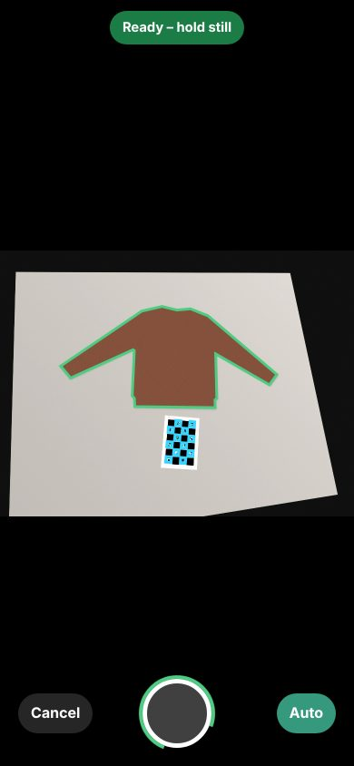
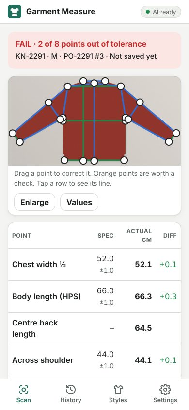
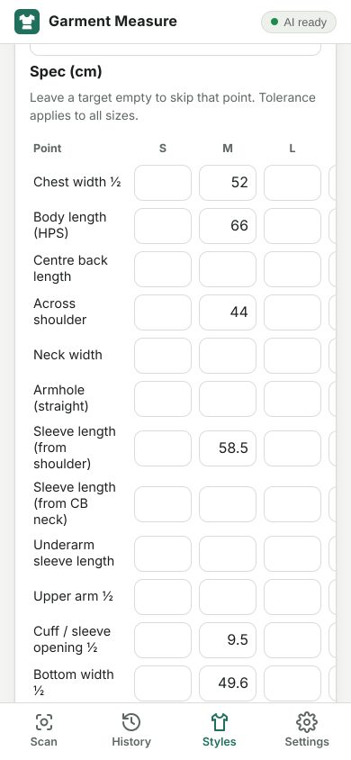

# Garment Measure

Point a phone at a garment lying flat on a table and get its measurements, checked against the
style's spec, with pass/fail per point, history and Excel export. Everything runs on your own
network: the server and the AI run on your DGX, and the phones open the app in their browser over Wi-Fi.

| Live camera | Result | Spec per style |
|---|---|---|
|  |  |  |

*(Screenshots from the automated end-to-end test: a phone-sized browser whose camera sees a synthetic photo.)*

## How it works

```
Phone (browser)                         DGX
  live camera ──small frames──▶  /api/preview: find the sheet + garment, draw the outline, "ready"
  full photo  ─────────────────▶ /api/measure:
                                   1. find the printed reference sheet (ChArUco) → real scale + perspective
                                   2. straighten the photo to a top-down view (2 px per mm)
                                   3. cut out the garment, straighten it on its mirror axis
                                   4. find armpits, shoulder points, cuffs, hem, crotch…
                                   5. measure, compare with the style spec → pass / fail
                                   6. Qwen (vLLM) checks the photo and writes a short QC note
```

- **The measuring is done by image processing (OpenCV), not by the AI.** A printed sheet with a
  known pattern gives the scale and corrects for the phone being held at an angle.
- **Qwen3.8-Flash-Next** (your vLLM) looks at the straightened photo for problems: folded sleeve,
  not flat, wrong garment type, sheet covered. It also writes a 2–4 sentence note on the results.
  It never changes a pass/fail, and if it is offline the app keeps working without it.
- Garments: **sweaters, cardigans, T-shirts / short sleeves, trousers, skirts**.
- Every point can be **dragged** on the phone if the automatic position is off. The numbers update
  live, and a magnifier shows the edge under your finger. Points that were hard to find are shown in orange.

### Measurement points

| Tops | Trousers | Skirts |
|---|---|---|
| Chest ½ (2.5 cm below armhole), body length from HPS, centre back length, across shoulder, neck width, armhole (straight), sleeve length from shoulder and from CB neck, underarm length, upper arm ½, cuff / sleeve opening ½, bottom width ½ | Waist ½, hip ½ (18 cm below waist), front rise, inseam, outseam, thigh ½, leg opening ½ | Waist ½, hip ½, length, hem sweep ½ |

Sleeve and leg measurements are given for both sides. The offsets (chest below armhole, hip below waist…) can be set per style.

## Accuracy

On synthetic phone photos with known true sizes (rendered with perspective, 10–26° tilt,
blur, noise, JPEG, knit texture, ~1.3–1.9 px per mm, which is a 12 MP photo of a 1.4 m wide sweater):

| Case | Typical error | Worst point |
|---|---|---|
| Sweater, 1 sheet | 0.8 mm | 2.2 mm |
| Sweater, 2 sheets, rotated 80°, auto-detected | 0.5 mm | 1.5 mm |
| Black drop-shoulder cardigan on light table | 0.5 mm | 1.7 mm |
| White T-shirt on dark table, auto-detected | 1.1 mm | 2.5 mm |
| Trousers (crotch-based: rise, inseam) | 0.5 mm | 2.9 mm (4.9 mm) |
| Skirt | 1.7 mm | 1.9 mm |

**Real garments will be less exact than this.** Knitwear stretches, curls at ribbed edges, and is
never laid out exactly the same way twice (3–8 mm between two lay-outs is normal). Before trusting
it for QC decisions, validate on your own garments (see [Validating on real garments](#validating-on-real-garments)).

What helps most, in order:
1. **Take photo** (full camera resolution) rather than a live video frame, with the garment filling the picture.
2. The sheet **flat** (glued to card) and close to the garment. A **second sheet** on the other side helps a lot on big garments.
3. Phone held **straight down**, about 1.2–1.6 m up, main lens (not ultra-wide).
4. A **plain table that contrasts** with the garment, even light.
5. Printer scale checked once (Settings → enter the measured ruler lengths).

---

## Setup on the DGX

Needs: Linux, Python ≥ 3.10, `openssl`, and your vLLM serving Qwen with image input. No GPU is used
by this app itself; all its packages are plain `pip` wheels (x86-64 and ARM64).

```bash
git clone <this repo> && cd <repo>/garment-measure
./run.sh            # first run: creates .venv, installs packages, makes .env and the HTTPS certificate
```

It prints the phone link and a QR code for the setup page:

```
   Phone app (live camera):  https://192.168.1.50:8443
   Setup page / photo mode:  http://192.168.1.50:8080/onboarding
```

### Connect it to your Qwen / vLLM

Edit `.env` (created from `.env.example`):

```ini
QWEN_BASE_URL=http://127.0.0.1:8000/v1   # where your vLLM listens (…/v1)
QWEN_MODEL=                              # empty = first model whose name contains "qwen"
QWEN_API_KEY=                            # only if vLLM was started with --api-key
```

Then check everything:

```bash
./run.sh doctor
[  OK ] vLLM at http://127.0.0.1:8000/v1 serves: Qwen/Qwen3.8-Flash-Next; using 'Qwen/Qwen3.8-Flash-Next'
[  OK ] Image request answered in 2.3s (structured output: yes): …
```

Notes:
- The app sends one ~1024 px JPEG per scan plus one short text request, through the standard
  `/v1/chat/completions` API. Thinking is switched off per request (`enable_thinking: false`), and
  any `<think>` text is stripped.
- It asks for JSON via `response_format` (structured output). If your vLLM build rejects that, it
  falls back to plain text automatically.
- AI jobs run one at a time in the background. The measurement shows immediately and the AI panel fills in a few seconds later.
- `QWEN_ENABLED=false` turns the AI off completely.

### Open the firewall (if enabled)

```bash
sudo ufw allow 8443/tcp && sudo ufw allow 8080/tcp
```

Give the DGX a **fixed IP** in your router (DHCP reservation). `run.sh` re-issues the certificate
automatically if the IP changes, and phones keep working without reinstalling anything.

### Start automatically

```bash
sudo cp scripts/garment-measure.service /etc/systemd/system/   # edit User= and paths first
sudo systemctl daemon-reload && sudo systemctl enable --now garment-measure
```

## Setting up a phone (once per phone)

On the phone, scan the QR code printed by `run.sh`, or open `http://<dgx-ip>:8080/onboarding`. The page walks through:

1. **Print the reference sheet** (`/marker.pdf`, 1 or 2 sheets) at **100 % / Actual size**, and glue it to card.
2. **Install the certificate.** Browsers only allow the live camera on a secure (https) page. The
   app creates its own small certificate authority (`certs/ca.crt`), and each phone installs it once:
   - *iPhone:* Safari → download → Settings → Profile Downloaded → Install → General → About →
     Certificate Trust Settings → turn on *Garment Measure Local CA*.
   - *Android:* Settings → Security → Encryption & credentials → Install a certificate → CA certificate.
3. Open `https://<dgx-ip>:8443` and **Add to Home Screen**. It then opens like an app.

If you can't or don't want to install the certificate, use the plain `http://<dgx-ip>:8080` link.
Live camera is off there, but **Take photo** (the phone's own camera app) works and gives the sharpest pictures.

Then in **Settings**, enter the measured lengths of the two rulers on your printout (they should be
150 mm and 250 mm). This corrects printer scaling.

## Using it

1. **Styles** tab → *New style*, or *Import CSV*. Enter targets per size and the tolerance.
2. Lay the garment flat, front up, collar or waistband toward the top of the screen, sleeves spread
   away from the body, trouser legs slightly apart. Put the sheet next to it, not touching.
3. **Scan** tab → pick style and size → **Live camera**. When the outline turns green and the
   phone is steady, it takes the photo by itself (or tap the button). Or use **Take photo**.
4. Check the result: green and red rows, orange points to look at, the AI note. Drag a point if
   needed, then **Save**.
5. **History** → filter by style → **Export Excel** (sheet *Scans* with pass/fail counts, sheet
   *Measurements* with one row per point).

### Spec CSV format

One row per style, size and point; values in cm. Download a filled-in example from Styles → *Template*.

```csv
style_code,style_name,customer,garment_type,size,point,target_cm,tol_minus_cm,tol_plus_cm
KN-1001,Crew neck sweater,Example brand,sweater,M,1/2 chest,52,1,1
KN-1001,Crew neck sweater,Example brand,sweater,M,body length,66,1,1
```

`garment_type` is one of `sweater, cardigan, tshirt, trousers, skirt`. Point names are matched
generously: `1/2 chest`, `chest width`, `body length`, `cb length`, `across shoulder`,
`sleeve length`, `cb sleeve`, `upper arm`, `cuff`, `1/2 bottom`, `waist`, `hip`, `front rise`,
`inseam`, `outseam`, `thigh`, `leg opening`, `hem sweep`…

Unknown names are listed after the import, and nothing is silently dropped.

### Optional PIN

Set `APP_PIN=1234` in `.env` if other people on the Wi-Fi shouldn't open the app. Phones ask for it once.

## Validating on real garments

Before relying on it, measure **20–30 real garments** of your usual types twice by hand (tape) and
twice with the app. Re-lay the garment between measurements and use two people if you can.
Compare per point:
- the average difference (bias), and
- the spread (the range that covers 95 % of the differences).

A point is fit for QC when the bias is under ~2 mm and the spread is well inside its tolerance.
Points that rely on seams the outline can't show (shoulder point on drop-shoulder or raglan knits,
neck width, crotch when legs touch) are marked orange. Check those by eye, or measure them by hand.

## Troubleshooting

| Problem | Fix |
|---|---|
| Phone can't open the page | Same Wi-Fi? Guest networks isolate devices. Firewall ports 8443/8080. Use the IP printed by `run.sh`. |
| "Not secure" warning / live camera button missing | Install the certificate (setup page), or use *Take photo*. |
| "Reference sheet not found" | The whole sheet must be visible, flat and sharp. Avoid glare on it. |
| "Part of the garment is outside the picture" | Step back or raise the phone. |
| "Could not find the armpits" | Spread the sleeves so there's table visible between sleeve and body. |
| Edges look wrong | Use a background that contrasts with the garment (dark garment on a light table or the other way round). |
| AI says "offline" | `./run.sh doctor`. Check `QWEN_BASE_URL` and that vLLM is running and serves an image-capable model. |

## Development

```bash
./run.sh test                       # 29 tests: measuring accuracy (synthetic photos), API, JS/Python parity
```

End-to-end test in a real browser with a simulated phone camera (needs Node + Playwright with Chromium):

```bash
.venv/bin/python -m uvicorn tests.fake_qwen:app --port 8001 &            # stand-in for vLLM
DATA_DIR=/tmp/gm QWEN_BASE_URL=http://127.0.0.1:8001/v1 \
  .venv/bin/python -m uvicorn app.main:create_app --factory --port 18080 &
.venv/bin/python tests/e2e/make_fake_camera.py sweater /tmp/cam.mjpeg
node tests/e2e/phone_flow.cjs http://127.0.0.1:18080 /tmp/cam.mjpeg /tmp/shots
```

```
garment-measure/
  cv/            measuring engine (no web code): board, homography, rectify, segment, orient,
                 landmarks_top / landmarks_bottom, catalogue (measurement definitions), pipeline, annotate
  app/           FastAPI server, SQLite, spec check, Excel/CSV export, Qwen client, doctor, serve
  static/        phone app (plain JavaScript, no build step), setup page
  scripts/       certificate script, systemd unit
  tests/         synthetic photo renderer with exact ground truth, accuracy/API tests, fake Qwen, e2e
```

Data lives in `data/` (SQLite `app.db` and `scans/<id>/photo.jpg, rect.jpg, annotated.jpg`).
Unsaved scans are deleted after 2 days.
